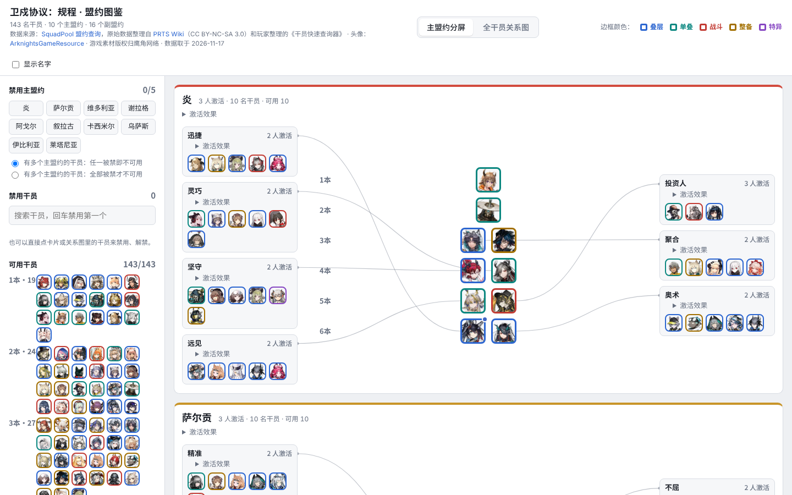
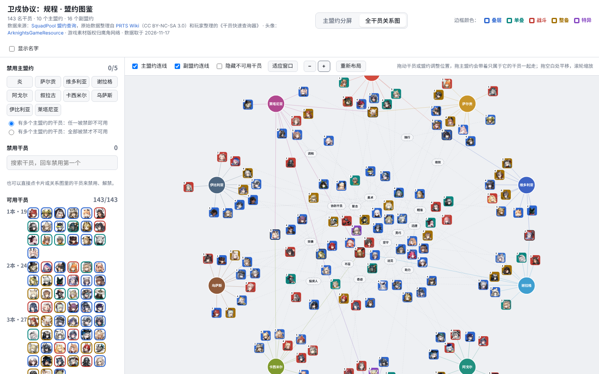
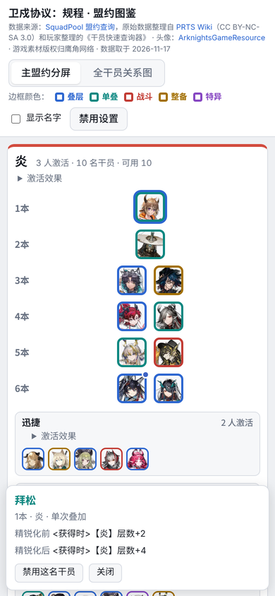

# 卫戍协议：规程 · 盟约图鉴

《明日方舟》「卫戍协议：规程」模式的盟约与干员速查工具。按主盟约查看干员搭配，按禁用条件筛选可用干员，在关系图里看清跨盟约的干员。

**在线使用：<https://devirunner.github.io/Ark-pacts/>**

电脑、平板、手机都能用。不需要注册，不收集任何数据。



## 功能

### 主盟约分屏

- 10 个主盟约各占一块，中间按 1–6 本排列该盟约的干员。
- 头像边框颜色代表干员作用：<br>
  🟦 叠层（持续叠加）　🟩 单叠（单次叠加）　🟥 战斗（作战能力）　🟨 整备（整备能力）　🟪 特异（特异化）
- 两侧列出这些干员所带的副盟约，按统一顺序排列，并用连线标出每名干员带的是哪些副盟约。副盟约框里列出只带副盟约、不带主盟约的干员。
- 同时属于多个主盟约的干员，头像右上角有对应盟约颜色的小圆点。
- 每个主盟约、副盟约都可以展开查看完整激活效果。
- 鼠标悬停（触屏上点按）头像，可以查看干员的本数、所属盟约，以及精锐化前后的特质。

### 禁用筛选

- 最多禁用 5 个主盟约，禁用干员的数量不限。
- 同时属于多个主盟约的干员，可以选择「任一主盟约被禁即不可用」或「全部主盟约被禁才不可用」。
- 侧栏按本数实时显示禁用后的可用干员。
- 禁用设置保存在本地浏览器里，刷新页面后不会丢失。

### 全干员关系图



- 全部 143 名干员在一张图里，按主盟约聚在一起。干员与所属的每个盟约都有连线，跨主盟约的干员一眼可见。
- 干员和盟约都可以拖动。拖动主盟约时，只属于它的干员会一起移动。调整后的布局会被记住，也可以一键重新布局。
- 支持滚轮或双指缩放，可以开关主盟约、副盟约连线，也可以隐藏不可用干员。

### 手机与平板



- 点头像会在底部弹出干员信息，弹窗里可以直接禁用。
- 手机竖屏时，禁用设置收进顶部按钮。
- 想像 App 一样使用，可以把网址添加到主屏幕：
  - iPhone / iPad：用 Safari 打开，点「分享」→「添加到主屏幕」。
  - 安卓：用浏览器打开，在菜单里选「添加到主屏幕」。

## 离线使用

下载本仓库（点「Code」→「Download ZIP」）并解压，用电脑浏览器打开 `index.html` 即可，不需要联网。

`index.html` 和 `heads/` 文件夹必须放在同一个目录，否则头像无法显示。手机直接打开本地文件通常加载不了头像，建议使用上面的在线版。

## 部署自己的副本

整个项目就是一个静态网页，没有构建步骤：

1. Fork 本仓库，或把 `index.html` 和 `heads/` 上传到你自己的公开仓库。
2. 打开仓库的 Settings → Pages，Source 选「Deploy from a branch」，分支选 `main`、目录选 `/ (root)`。
3. 几分钟后访问 `https://<你的用户名>.github.io/<仓库名>/`。

也可以上传到其他任意静态托管服务（如阿里云 OSS、腾讯云 COS），上传时保持目录结构不变。

## 文件结构

```
index.html     页面本体（包含全部干员与盟约数据）
heads/         143 个干员头像（96×96 WebP）
screenshots/   README 用截图，网页运行不需要
```

## 数据来源与致谢

数据日期：2026-11-17。共 143 名干员、10 个主盟约、16 个副盟约。

- 干员、盟约、特质数据：[SquadPool 盟约查询](https://squad-pool.com/arknights-pacts)
  - 原始数据整理自 [PRTS Wiki](https://prts.wiki/)，采用 [CC BY-NC-SA 3.0](https://creativecommons.org/licenses/by-nc-sa/3.0/deed.zh-hans) 协议
  - 售价与触发时机来自玩家整理的《干员快速查询器》
- 干员头像：[yuanyan3060/ArknightsGameResource](https://github.com/yuanyan3060/ArknightsGameResource)

感谢以上项目和维护者。数据如与游戏内不一致，以游戏内为准。发现错误或数据过时，欢迎提交 [Issue](https://github.com/DeviRunner/Ark-pacts/issues)。

## 许可与声明

- 本项目包含的游戏数据整理自 PRTS Wiki，因此整个项目按 [CC BY-NC-SA 3.0](https://creativecommons.org/licenses/by-nc-sa/3.0/deed.zh-hans) 发布：可以自由转载和修改，但须注明出处、不得用于商业用途、衍生作品须使用相同协议。
- 《明日方舟》及相关游戏素材（含干员头像）的版权归上海鹰角网络科技有限公司（Hypergryph）所有。
- 本项目为玩家自制的非官方工具，与鹰角网络无任何关联。
